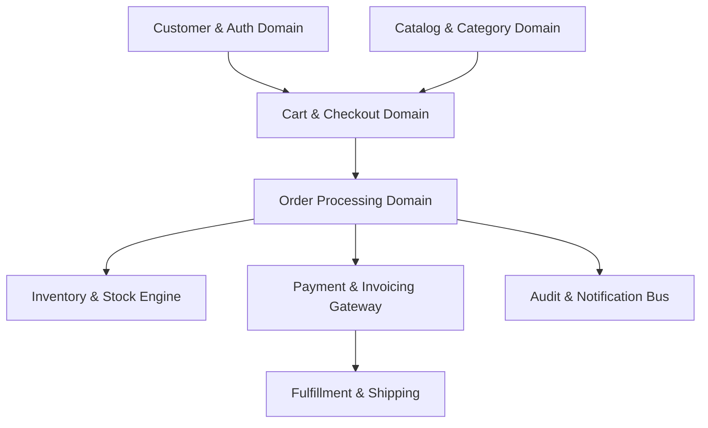
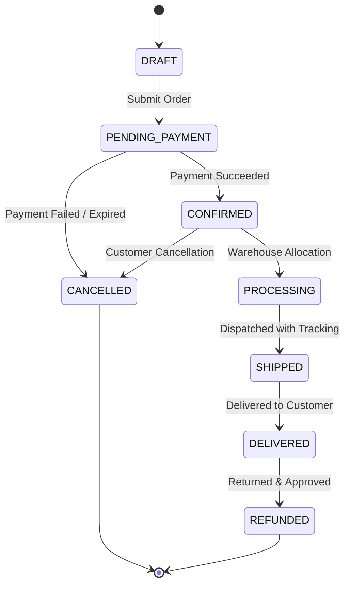

<!-- @generated-by Antigravity - Authorized AI: Antigravity Only -->

# 🛍️ MyShop — Core Business Logic & Domain Specifications

> **Notice**: This document defines the business domain models, transactional rules, state machines, and operational invariants for **MyShop**. The backend API (Fastify, Prisma, Supabase) is built and validated against the specifications outlined here.

---

## 📑 Table of Contents
1. [Domain Architecture Overview](#1-domain-architecture-overview)
2. [Global Invariants & System Constraints](#2-global-invariants--system-constraints)
3. [User & Customer Management (Auth & RBAC)](#3-user--customer-management-auth--rbac)
4. [Catalog & Category Management](#4-catalog--category-management)
5. [Inventory & Stock Control](#5-inventory--stock-control)
6. [Shopping Cart & Session Logic](#6-shopping-cart--session-logic)
7. [Order Processing & Lifecycle State Machine](#7-order-processing--lifecycle-state-machine)
8. [Pricing, Discounts & Taxes Engine](#8-pricing-discounts--taxes-engine)
9. [Payment Processing & Webhooks](#9-payment-processing--webhooks)
10. [Fulfillment & Shipping](#10-fulfillment--shipping)
11. [Returns, Refunds & Cancellations](#11-returns-refunds--cancellations)
12. [Data Protection, Privacy & Audit Trail](#12-data-protection-privacy--audit-trail)
13. [Custom Business Rules & Logic Workspace](#13-custom-business-rules--logic-workspace)

---

## 1. Domain Architecture Overview

MyShop is structured around discrete domain contexts:



---

## 2. Global Invariants & System Constraints

All backend routes and database mutations must strictly enforce these foundational rules:

1. **Zero-Deletion Policy**:
   - Entities (`Category`, `Product`, `Order`, `Customer`, etc.) must **never be hard-deleted** from the database.
   - All deletions are soft-deletes implemented using `deletedAt TIMESTAMP WITH TIME ZONE DEFAULT NULL`.
   - Queries must default to filtering out soft-deleted records (`WHERE "deletedAt" IS NULL`).
2. **Database Row-Level Security (RLS)**:
   - Supabase Row-Level Security must remain active on all database tables.
   - Customers may only read/modify their own personal records.
   - Public read access is strictly limited to non-deleted, active products and categories.
3. **Financial Precision**:
   - Currency amounts must be stored as fixed-precision decimals (or integer cents) to prevent IEEE-754 floating-point rounding errors.
   - All line-item computations must be rounded to 2 decimal places.
4. **Idempotency**:
   - Payment capture and order submission endpoints must require an `Idempotency-Key` header to prevent duplicate charges or double orders during network retries.

---

## 3. User & Customer Management (Auth & RBAC)

### 3.1 Roles & Permissions
- **Guest**: Can browse catalog, search products, add items to a temporary guest cart.
- **Customer**: Authenticated via Supabase Auth (`auth.users`). Can maintain saved addresses, view personal order history, and leave reviews.
- **Store Manager**: Can manage catalog entries, adjust stock counts, update order fulfillment status.
- **Admin**: Full administrative privileges, access to financial reports, user management, and system logs.

### 3.2 Customer Business Rules
- Customer email addresses must be unique and validated using RFC 5322 format.
- Personal Identifiable Information (PII) such as passwords or payment tokens must never be logged in application traces.

---

## 4. Catalog & Category Management

### 4.1 Categories
- Categories support hierarchical structures (`parentId` referencing parent category).
- Category names must be unique within their hierarchy level.
- Deleting a category with active products is forbidden; products must first be re-assigned or soft-archived.

### 4.2 Saree Catalog & Reselling Entity
For the saree reselling business, each catalog entry tracks procurement costs, retail pricing, fabric categories, and inventory:

- **Tracked Core Fields**:
  - `name`: Saree title/design name (e.g., *"Banarasi Katan Silk Handloom Saree"*).
  - `category`: Category / fabric classification (e.g., *Silk, Banarasi, Cotton, Chiffon, Georgette, Kanjeevaram, Organza, Linen*).
  - `costPrice` (CP): Procurement / wholesale acquisition cost paid to weaver or vendor.
    - **Access Control**: Confidential internal field. Must **never be exposed** to public storefront APIs or unauthenticated users.
  - `sellingPrice` (SP): Retail price offered to customers.
    - **Automated Pricing Rule**: $\text{Selling Price} = \text{Cost Price} + 65\% = \text{Cost Price} \times 1.65$.
  - `stock`: Current stock count (often single-piece unique items `stock = 1` for handlooms, or batch counts).
  - `status`: Enum (`draft`, `active`, `archived`). Only `active` sarees appear on the public storefront.

- **Optional Saree Attributes**:
  - `fabric`: Base material (e.g., Pure Silk, Tussar, Chanderi, Mulmul).
  - `weave`: Weaving technique (e.g., Jacquard, Zari, Handloom, Printed).
  - `color`: Primary and secondary body colors.
  - `blousePiece`: Boolean (`true` if unstitched blouse piece is included, `false` otherwise).
  - `length`: Standard saree length (default $5.5\text{m} + 0.8\text{m}$ blouse piece).
  - `careInstructions`: e.g., "Dry Clean Only".

- **Validation & Invariants**:
  - `costPrice` must be strictly positive ($\text{CP} > 0$).
  - `sellingPrice` is automatically derived as $\text{CP} \times 1.65$ upon product creation and whenever `costPrice` is modified.
  - Manual overrides of `sellingPrice` that violate the $+65\%$ markup rule are rejected by API validation.
  - Archiving sets `status = 'archived'` and timestamps `deletedAt` (Zero-Deletion Directive). Historical orders preserve the snapshot of `name`, `costPrice`, and `sellingPrice` at time of purchase.

---

## 5. Inventory & Stock Control

### 5.1 Invariants
- **Atomic Deduction**: Stock must be deducted inside a database transaction (`prisma.$transaction`) during order placement.
- **No Negative Inventory**: A product's stock count can never drop below zero. If `requested_quantity > available_stock`, the entire checkout transaction fails with `400 Bad Request`.
- **Concurrency Protection**: Inventory updates must use optimistic locking or database row locking (`SELECT ... FOR UPDATE`) to eliminate race conditions under concurrent checkouts.

### 5.2 Stock States
- **In Stock**: `stock > low_stock_threshold`
- **Low Stock**: `1 <= stock <= low_stock_threshold` (triggers admin notification)
- **Out of Stock**: `stock == 0` (product cannot be added to cart)

---

## 6. Shopping Cart & Session Logic

### 6.1 Cart Mechanics
- Carts can exist in two modes:
  1. **Guest Cart**: Bound to a cryptographically secure session cookie / UUID with a 7-day TTL.
  2. **Customer Cart**: Bound to `customer_id` stored in database.
- **Cart Merging**: When a guest logs in with an active guest cart, items are merged into their customer cart (quantities aggregated up to current available stock).

### 6.2 Price Staleness
- Adding an item to the cart stores the product reference, not a locked price.
- Cart totals are re-calculated dynamically against the catalog prior to checkout initiation.

---

## 7. Order Processing & Lifecycle State Machine

### 7.1 State Machine
Orders transition strictly through the following states:



### 7.2 Atomic Checkout Transaction Steps
During `POST /api/v1/orders`:
1. Verify customer identity (authenticated JWT or guest contact payload).
2. Validate line items (minimum 1 item, valid quantities).
3. Lock product rows in database.
4. Verify prices against active catalog and recalculate total amount.
5. Verify available stock for every line item.
6. Atomically decrement stock counts.
7. Insert `Order` and `OrderItem` records.
8. Set order status to `CONFIRMED` (or `PENDING_PAYMENT` if gateway deferred).
9. Emit order confirmation event.

---

## 8. Pricing, Discounts & Taxes Engine

### 8.1 Saree Reselling Markup Formula (+65% Rule)
Every saree's selling price is strictly derived from its procurement cost price using a mandatory $+65\%$ markup:

$$\text{Selling Price (SP)} = \text{Cost Price (CP)} \times (1 + 0.65) = \text{Cost Price} \times 1.65$$
$$\text{Gross Profit} = \text{Selling Price} - \text{Cost Price} = 0.65 \times \text{Cost Price}$$
$$\text{Gross Margin \%} = \left(\frac{\text{Selling Price} - \text{Cost Price}}{\text{Selling Price}}\right) \times 100 \approx 39.39\%$$

#### Invariants:
1. **Automated Computation**:
   When an admin inputs `costPrice`, the backend computes:
   ```javascript
   sellingPrice = Number((costPrice * 1.65).toFixed(2));
   ```
2. **Cost Price Protection**:
   `costPrice` is accessible **only** to users with the `Admin` or `Store_Manager` role. Customer-facing queries, storefront catalogs, and search listings must **omit** `costPrice` to protect vendor margins.
3. **Consistency on Update**:
   Any modification to `costPrice` automatically recalculates `sellingPrice` unless an explicit promotional override is applied.

### 8.2 Order & Checkout Calculation Formula
$$\text{Line Item Total} = \text{Quantity} \times \text{Selling Price}$$
$$\text{Subtotal} = \sum (\text{Line Item Totals})$$
$$\text{Tax Amount} = (\text{Subtotal} - \text{Discount}) \times \text{Tax Rate}$$
$$\text{Grand Total} = \text{Subtotal} - \text{Discount} + \text{Tax Amount} + \text{Shipping Fee}$$

### 8.3 Coupon & Promo Code Invariants
- Coupons validate: minimum cart value, expiry date, maximum usage count, user eligibility.
- Discounts cannot reduce order total below zero.
- Promotional discounts reduce the `sellingPrice` directly without modifying the underlying `costPrice`.

---

## 9. Payment Processing & Webhooks

- Payments are processed via external gateways (e.g., Stripe, Razorpay).
- Raw credit card numbers or CVVs **must never touch** the MyShop application server (PCI-DSS compliance).
- Webhook endpoints must verify cryptographic signatures before processing state transitions.
- Duplicate webhook events must be ignored gracefully via transaction deduplication.

---

## 10. Fulfillment & Shipping

- An order can only be marked `SHIPPED` once a carrier name and tracking number are assigned.
- Upon `SHIPPED` status, tracking details are sent to the customer email.
- Delivery confirmation changes state to `DELIVERED`, opening the return window.

---

## 11. Returns, Refunds & Cancellations

- **Cancellation Window**: Customers may cancel an order before it enters `PROCESSING` status. Cancelled orders automatically restock inventory atomically.
- **Return Policy**: Eligible within 14 days after `DELIVERED` status.
- **Refund Invariant**: Refunds can never exceed the original paid amount.

---

## 12. Data Protection, Privacy & Audit Trail

- **PII Redaction**: Application logs (via Pino) must redact headers, cookies, passwords, and tokens.
- **Audit Logging**: Any manual price change, stock override, or order cancellation must write an entry to an append-only `AuditLog` table with the actor ID and timestamp.

---

## 13. Saree Reselling Business Rules & Specifications

### 13.1 Core Saree Tracking Matrix
Every saree in inventory must track and record the following attributes:

| Field Name | Type | Description | Visibility | Invariant / Validation Rule |
| :--- | :--- | :--- | :--- | :--- |
| `name` | String | Saree title / design identifier | Public | Required. Minimum 3 characters. |
| `category` | String / Enum | Saree category / weave classification | Public | Required. Matches valid category list. |
| `costPrice` (CP) | Decimal / Float | Procurement cost paid to vendor / weaver | **Admin / Internal Only** | Required. $\text{CP} > 0$. Never exposed to customer. |
| `sellingPrice` (SP) | Decimal / Float | Retail price charged to customer | Public | Auto-calculated: $\text{SP} = \text{CP} \times 1.65$. |
| `stock` | Integer | Available inventory count | Public | Non-negative integer. Default = 1 (single-piece design). |
| `profit` | Decimal / Float | Expected gross profit per unit | **Admin / Internal Only** | Auto-calculated: $\text{Profit} = \text{SP} - \text{CP} = 0.65 \times \text{CP}$. |

---

### 13.2 The Mandatory +65% Markup Rule
- **Rule Definition**: The selling price of every saree is **always** equal to its Cost Price plus a $65\%$ markup:
  $$\mathbf{Selling\ Price = Cost\ Price \times 1.65}$$
- **Examples**:
  - Procurement Cost $\text{CP} = ₹1,000$ $\implies$ Selling Price $\text{SP} = ₹1,650$ (Gross Profit $= ₹650$)
  - Procurement Cost $\text{CP} = ₹2,500$ $\implies$ Selling Price $\text{SP} = ₹4,125$ (Gross Profit $= ₹1,625$)
  - Procurement Cost $\text{CP} = ₹8,000$ $\implies$ Selling Price $\text{SP} = ₹13,200$ (Gross Profit $= ₹5,200$)
- **API Implementation Contract**:
  - When creating a product (`POST /api/v1/products`), the request payload provides `costPrice`. The backend service calculates:
    ```javascript
    sellingPrice = Math.round(costPrice * 1.65 * 100) / 100;
    ```
  - If a user updates `costPrice` (`PUT /api/v1/products/:id`), `sellingPrice` is dynamically recalculated to maintain the $+65\%$ margin.

---

### 13.3 Saree Category Taxonomy
The following primary categories and weaves are supported:
- **Silk Sarees**: Kanjeevaram, Banarasi Katan, Tussar Silk, Raw Silk, Chanderi Silk.
- **Cotton & Handloom**: Pure Cotton, Mulmul, Linen, Khadi, Jamdani.
- **Party & Contemporary**: Organza, Georgette, Chiffon, Net, Crepe.
- **Traditional & Regional**: Paithani, Bandhani, Patola, Sambalpuri, Kasavu.

---

### 13.4 Saree Inventory & Single-Piece Exclusivity
- Many handloom and designer sarees are **single-piece unique items** (`stock = 1`).
- When a customer purchases a single-piece saree, it immediately transitions to `OUT_OF_STOCK` and cannot be added to other carts.
- Concurrency control ensures two customers cannot purchase the same single-piece saree simultaneously.

---

### 13.5 Custom Business Rules Workspace
*(Add any additional custom promotion, return, or vendor rules below)*

- [x] **Cost Price Tracking**: Track procurement cost per piece internally.
- [x] **Automated 65% Markup**: Strictly compute $\text{Selling Price} = \text{Cost Price} \times 1.65$.
- [x] **Category Association**: Every saree must be mapped to a valid category.
- [ ] *Custom: Free shipping on orders containing 2 or more sarees.*
- [ ] *Custom: Optional blouse stitching add-on service fee.*
- [ ] *Custom: Silk Mark Certification tracking for pure silk categories.*

