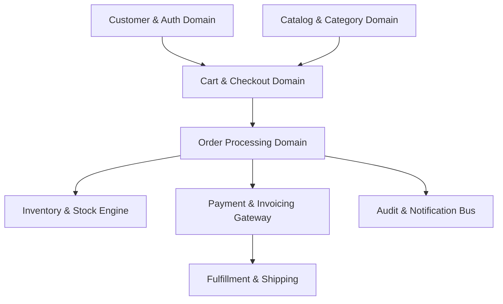
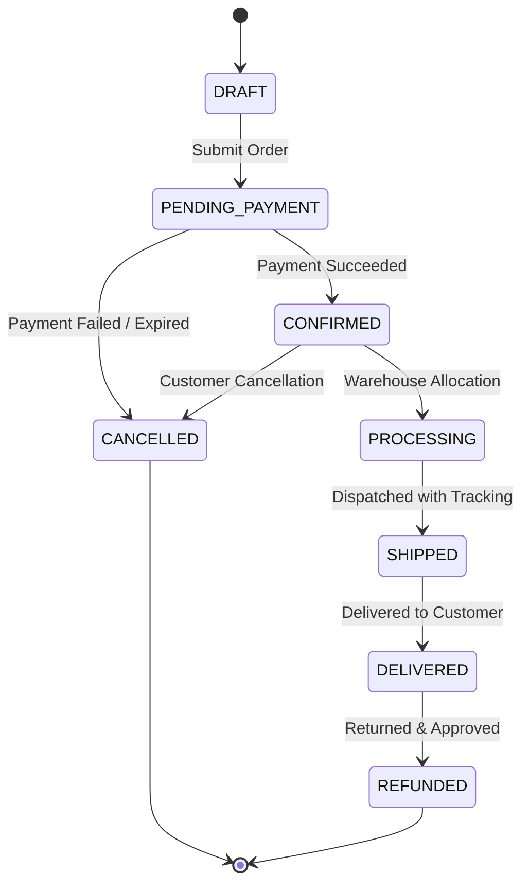

<!-- @generated-by Antigravity - Authorized AI: Antigravity Only -->

# 🛍️ MyShop — Core Business Logic & Domain Specifications

> **Notice**: This document defines the business domain models, transactional rules, state machines, and operational invariants for **MyShop**. The backend API (Fastify, Prisma, Supabase) is built and validated against the specifications outlined here.

---

## 📑 Table of Contents
1. [Domain Architecture Overview](#1-domain-architecture-overview)
2. [Global Invariants & System Constraints](#2-global-invariants--system-constraints)
3. [User & Customer Management (Auth & RBAC)](#3-user--customer-management-auth--rbac)
4. [Catalog & Category Management](#4-catalog--category-management)
5. [Inventory & Stock Control](#5-inventory--stock-control)
6. [Shopping Cart & Session Logic](#6-shopping-cart--session-logic)
7. [Order Processing & Lifecycle State Machine](#7-order-processing--lifecycle-state-machine)
8. [Pricing, Discounts & Taxes Engine](#8-pricing-discounts--taxes-engine)
9. [Payment Processing & Webhooks](#9-payment-processing--webhooks)
10. [Fulfillment & Shipping](#10-fulfillment--shipping)
11. [Returns, Refunds & Cancellations](#11-returns-refunds--cancellations)
12. [Data Protection, Privacy & Audit Trail](#12-data-protection-privacy--audit-trail)
13. [Custom Business Rules & Logic Workspace](#13-custom-business-rules--logic-workspace)

---

## 1. Domain Architecture Overview

MyShop is structured around discrete domain contexts:

---

## 2. Global Invariants & System Constraints

All backend routes and database mutations must strictly enforce these foundational rules:

1. **Zero-Deletion Policy**:
   - Entities (`Category`, `Product`, `Order`, `Customer`, etc.) must **never be hard-deleted** from the database.
   - All deletions are soft-deletes implemented using `deletedAt TIMESTAMP WITH TIME ZONE DEFAULT NULL`.
   - Queries must default to filtering out soft-deleted records (`WHERE "deletedAt" IS NULL`).
2. **Database Row-Level Security (RLS)**:
   - Supabase Row-Level Security must remain active on all database tables.
   - Customers may only read/modify their own personal records.
   - Public read access is strictly limited to non-deleted, active products and categories.
3. **Financial Precision**:
   - Currency amounts must be stored as fixed-precision decimals (or integer cents) to prevent IEEE-754 floating-point rounding errors.
   - All line-item computations must be rounded to 2 decimal places.
4. **Idempotency**:
   - Payment capture and order submission endpoints must require an `Idempotency-Key` header to prevent duplicate charges or double orders during network retries.

---

## 3. User & Customer Management (Auth & RBAC)

### 3.1 Roles & Permissions
- **Guest**: Can browse catalog, search products, add items to a temporary guest cart.
- **Customer**: Authenticated via Supabase Auth (`auth.users`). Can maintain saved addresses, view personal order history, and leave reviews.
- **Store Manager**: Can manage catalog entries, adjust stock counts, update order fulfillment status.
- **Admin**: Full administrative privileges, access to financial reports, user management, and system logs.

### 3.2 Customer Business Rules
- Customer email addresses must be unique and validated using RFC 5322 format.
- Personal Identifiable Information (PII) such as passwords or payment tokens must never be logged in application traces.

---

## 4. Catalog & Category Management

### 4.1 Categories
- Categories support hierarchical structures (`parentId` referencing parent category).
- Category names must be unique within their hierarchy level.
- Deleting a category with active products is forbidden; products must first be re-assigned or soft-archived.

### 4.2 Products
- **Required Fields**: `name`, `price`, `categoryId`, `stock`.
- **Validation**:
  - `price`: Must be greater than 0 (`price > 0`).
  - `stock`: Non-negative integer (`stock >= 0`).
  - `status`: Enum (`draft`, `active`, `archived`). Only `active` products are visible on public storefront endpoints.
- **Archiving**:
  - Archiving sets `status = 'archived'` and timestamps `deletedAt`.
  - Existing completed or active orders referencing an archived product preserve the historical product snapshot (name and unit price at checkout time).

---

## 5. Inventory & Stock Control

### 5.1 Invariants
- **Atomic Deduction**: Stock must be deducted inside a database transaction (`prisma.$transaction`) during order placement.
- **No Negative Inventory**: A product's stock count can never drop below zero. If `requested_quantity > available_stock`, the entire checkout transaction fails with `400 Bad Request`.
- **Concurrency Protection**: Inventory updates must use optimistic locking or database row locking (`SELECT ... FOR UPDATE`) to eliminate race conditions under concurrent checkouts.

### 5.2 Stock States
- **In Stock**: `stock > low_stock_threshold`
- **Low Stock**: `1 <= stock <= low_stock_threshold` (triggers admin notification)
- **Out of Stock**: `stock == 0` (product cannot be added to cart)

---

## 6. Shopping Cart & Session Logic

### 6.1 Cart Mechanics
- Carts can exist in two modes:
  1. **Guest Cart**: Bound to a cryptographically secure session cookie / UUID with a 7-day TTL.
  2. **Customer Cart**: Bound to `customer_id` stored in database.
- **Cart Merging**: When a guest logs in with an active guest cart, items are merged into their customer cart (quantities aggregated up to current available stock).

### 6.2 Price Staleness
- Adding an item to the cart stores the product reference, not a locked price.
- Cart totals are re-calculated dynamically against the catalog prior to checkout initiation.

---

## 7. Order Processing & Lifecycle State Machine

### 7.1 State Machine
Orders transition strictly through the following states:

### 7.2 Atomic Checkout Transaction Steps
During `POST /api/v1/orders`:
1. Verify customer identity (authenticated JWT or guest contact payload).
2. Validate line items (minimum 1 item, valid quantities).
3. Lock product rows in database.
4. Verify prices against active catalog and recalculate total amount.
5. Verify available stock for every line item.
6. Atomically decrement stock counts.
7. Insert `Order` and `OrderItem` records.
8. Set order status to `CONFIRMED` (or `PENDING_PAYMENT` if gateway deferred).
9. Emit order confirmation event.

---

## 8. Pricing, Discounts & Taxes Engine

### 8.1 Calculation Formula
$$\text{Line Item Total} = \text{Quantity} \times \text{Unit Price}$$
$$\text{Subtotal} = \sum (\text{Line Item Totals})$$
$$\text{Tax Amount} = (\text{Subtotal} - \text{Discount}) \times \text{Tax Rate}$$
$$\text{Grand Total} = \text{Subtotal} - \text{Discount} + \text{Tax Amount} + \text{Shipping Fee}$$

### 8.2 Coupon & Promo Code Invariants
- Coupons validate: minimum cart value, expiry date, maximum usage count, user eligibility.
- Discounts cannot reduce order total below zero.

---

## 9. Payment Processing & Webhooks

- Payments are processed via external gateways (e.g., Stripe, Razorpay).
- Raw credit card numbers or CVVs **must never touch** the MyShop application server (PCI-DSS compliance).
- Webhook endpoints must verify cryptographic signatures before processing state transitions.
- Duplicate webhook events must be ignored gracefully via transaction deduplication.

---

## 10. Fulfillment & Shipping

- An order can only be marked `SHIPPED` once a carrier name and tracking number are assigned.
- Upon `SHIPPED` status, tracking details are sent to the customer email.
- Delivery confirmation changes state to `DELIVERED`, opening the return window.

---

## 11. Returns, Refunds & Cancellations

- **Cancellation Window**: Customers may cancel an order before it enters `PROCESSING` status. Cancelled orders automatically restock inventory atomically.
- **Return Policy**: Eligible within 14 days after `DELIVERED` status.
- **Refund Invariant**: Refunds can never exceed the original paid amount.

---

## 12. Data Protection, Privacy & Audit Trail

- **PII Redaction**: Application logs (via Pino) must redact headers, cookies, passwords, and tokens.
- **Audit Logging**: Any manual price change, stock override, or order cancellation must write an entry to an append-only `AuditLog` table with the actor ID and timestamp.

---

## 13. Custom Business Rules & Logic Workspace

*(Use this space to add project-specific rules, discounts, edge cases, and business requirements)*

### 13.1 Custom Catalog Rules
<!-- Write your custom rules here -->
- [ ] *Example: Limit purchase of high-demand items to 2 per customer.*

### 13.2 Custom Shipping Rules
<!-- Write your custom rules here -->
- [ ] *Example: Free shipping on orders over $50.*

### 13.3 Custom Promotions & Loyalty
<!-- Write your custom rules here -->
- [ ] *Example: 10% discount on first order for registered users.*

### 13.4 Custom Notifications & Webhooks
<!-- Write your custom rules here -->
- [ ] *Example: Send Telegram / WhatsApp alert on orders exceeding $500.*
